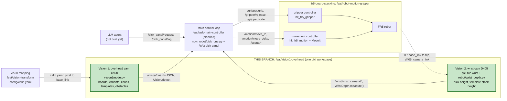

# Vision 1 (overhead cam) + Vision 2 (wrist cam): board detection, wrist depth and supervised pick / place (branch `feat/vision1-overhead`)

This branch is a standalone pixi workspace (ROS 2 Humble, RoboStack) that runs **next to** the robot workspace
`fr5-board-stacking` (branch `feat/robot-motion-gripper`) on the same machine and ROS domain. It gives you:

| Part | What it does | Entry point |
|---|---|---|
| Overhead vision node | Logitech C920 above the table -> boards (variant, pose in `base_link`), boards under other boards, destination templates | `pixi run -e gpu vision` |
| Wrist camera | RealSense D405 on the tool -> color image, point cloud, placed on the robot model | `pixi run wrist` |
| Wrist depth | Board / stack top height under the cup from the D405 (Python API) | `robot/wrist_depth.py` |
| Pick / place script | Supervised pick of one board and place on its template (ENTER before every descent) | `robot/pick_one.py` |
| RViz demo panel | Status lights, both cameras, one button per variant, Confirm / Stop, log; ROS request topic | `robot/rviz.sh` |
| Learned segmenter | YOLO26s-seg (ONNX) for touching / stacked boards, trained on this lab's data | `models/boards-seg.onnx` |


*The workcell: FR5 on its rail, pick table (front right), templates with ArUco tags, overhead C920 above the tables
(not visible), D405 on the wrist.*


*`robot/rviz.sh` on the real robot right after a successful VARc pick and place (status line, both cameras, variant
buttons, log; 3D: robot, D405 point cloud, green = detected boards, red = template poses).*

## Where this branch sits in the team graph

![Team architecture graph (planned): Main control loop (maybe state machines) in the centre, connected to an LLM
agent (task scheduling, adds intelligence), vis-irl mapping for Vision 1 (image pixels to robot base coordinates),
gripper controller and movement controller (both to the robot), Vision 1 overhead cam (board location, board
variants, areas processing / drop-off, obstacles such as hands or unknown objects) and Vision 2 wrist cam (depth
perception while picking a board). Colour legend in the drawing: green = done, tested and verified; blue = no work
done yet; yellow = lagging; orange = seriously lagging](docs/img/team_architecture_graph.png)

*The team's planned architecture, used by all agents for development (status colours as drawn by the team).*

The same graph as text (Mermaid), with the interfaces between the nodes:



**The two bottom nodes, Vision 1 (overhead cam) and Vision 2 (wrist cam), both live in this branch and this pixi
workspace** (`feat/vision1-overhead`, `vision1-overhead/`). The name says "vision1", but the wrist camera work
(Vision 2) is here too. Map from the graph to the code:

| Graph node | Where | What it provides here |
|---|---|---|
| **Vision 1, overhead cam** | **this branch**: `vision1/node.py`, `detect.py`, `seg.py`, `table.py` | board location (`x`, `y`, `yaw` in `base_link`), variant (`VARa` / `VARb` / `VARc` / `UNKWN`), areas (`zone` pick / drop, `destinations` = templates), obstacles (`rejected`: hand / arm / unknown blobs; `occluded` / `covered_by`: boards under boards). API: `/vision/boards`, `/vision/detect`, `/vision/image`, `/vision/markers` |
| **Vision 2, wrist cam** | **this branch**: `pixi run wrist` (`vision1/wrist.launch.py`, `config/d405.yaml`), `robot/wrist_depth.py`, `robot/check_wrist.py` | depth while picking: board / stack top under the cup (pick height) and stack height on the template (place height); D405 image + point cloud on the robot model. API: `/wrist/wrist_camera/*` topics, `WristDepth.measure()` |
| vis-irl mapping for Vision 1 | `feat/vision-transform` (calibration app) -> `config/calib.yaml` here, used by `vision1/table.py` | pixel -> `base_link` x / y (table-plane homography, rms ~1.4 mm) |
| Main control loop | `feat/task-main-controller` (planned); here `robot/pick_one.py` is a minimal supervised loop (one board per run) and the RViz panel its UI | consumes `/vision/boards` + `WristDepth`, sends `/motion/*`, `/gripper/*`, `/scene/*` |
| LLM agent | not here; hook ready: `/pick_panel/request` (`VARa` / `VARb` / `VARc` / `stop`) and `/pick_panel/log` | ask for a pick by variant, read the outcome |
| Gripper controller, movement controller, robot | `fr5-board-stacking` (`feat/robot-motion-gripper`): `hk_fr5_gripper`, `hk_fr5_motion`, `hk_fr5_moveit_config` | `/gripper/grip`, `/gripper/release`, `/gripper/state`, `/motion/move_to`, `/motion/move_delta`, `/scene/*` (section 4.6) |

Contents: [Team graph](#where-this-branch-sits-in-the-team-graph) · [Quick start](#1-quick-start) · [Environments and tasks](#2-environments-and-tasks) ·
[Data flow](#3-data-flow) · [ROS interface](#4-ros-interface-reference) · [`/vision/boards` JSON](#5-visionboards-json-schema) ·
[Coordinates](#6-coordinate-conventions) · [pick_one.py](#7-pick_onepy-supervised-pick--place) ·
[RViz panel](#8-rviz-pick-panel) · [Wrist D405](#9-wrist-camera-realsense-d405) · [Integration recipes](#10-integration-recipes) ·
[Config and calibration](#11-configuration-and-calibration) · [Model](#12-learned-model-and-training) · [Tests](#13-tests) ·
[Measured on the real robot](#14-values-measured-on-the-real-robot) · [Troubleshooting](#15-troubleshooting) · [Limits](#16-limits)

---

## 1. Quick start

Both repositories side by side:

```text
durst_hackathon/
├── fr5-board-stacking/   # robot: MoveIt, ros2_control, /motion/*, /gripper/*, /scene/* (branch feat/robot-motion-gripper)
└── vision1-overhead/     # this branch
```

```bash
git clone -b feat/vision1-overhead https://github.com/AtharvaBhorpe/fr5-board-stacking.git vision1-overhead
cd vision1-overhead && pixi install                 # default env (CPU); add: pixi install -e gpu (NVIDIA)
```

### Real robot (4 terminals)

```bash
cd fr5-board-stacking && pixi run robot use_rviz:=false                  # 1. robot stack (human at the e-stop)
cd vision1-overhead   && pixi run -e gpu vision --ros-args -p model:=true # 2. overhead camera (no GPU: pixi run vision ...)
cd vision1-overhead   && pixi run wrist                                  # 3. wrist D405 (optional, gives dynamic heights)
cd vision1-overhead   && robot/rviz.sh                                   # 4. RViz + pick panel (builds the panel first)
```

In the panel: set `extra args` to `--speed 0.1`, click a variant (or a board in the camera image), press
**Confirm** at each yellow prompt.

### Simulation (no robot, no camera)

```bash
cd fr5-board-stacking && pixi run sim use_rviz:=false
cd vision1-overhead   && cp samples/composite_vara_dest.png /tmp/scene.png && pixi run vision --ros-args -p device:=/tmp/scene.png
cd vision1-overhead   && robot/rviz.sh
```

`device:=<image file>` replays a photo; the file is re-read every tick, so `cp other.png /tmp/scene.png` changes
the scene while the node runs.

> **Never run `sim` and `robot` at the same time.** A leftover sim `robot_state_publisher` once made the real
> robot load mock hardware: it reported SUCCESS but did not move. `pick_one.py` prints `robot hardware: REAL FR5`
> or `MOCK` first and stops if two robot stacks publish `/robot_description`. Check before a real session:
> `ps -eo pid,cmd | grep -E "[m]ove_group|[r]os2_control_node|[n]ode.py|[r]viz2"` must be empty.

---

## 2. Environments and tasks

`pixi.toml` defines three environments:

| Env | Platform | Use | Notes |
|---|---|---|---|
| `default` | linux-64 (glibc 2.34) | ROS nodes on any PC | onnxruntime CPU (model ~1 s / frame) |
| `gpu` | linux-64 + CUDA 12.8 | ROS nodes with an NVIDIA GPU | onnxruntime CUDA build: model 20-30 ms, full frame ~100 ms |
| `train` | linux-64 + CUDA 12.8 | dataset / training / SAM labelling | Python 3.12, pytorch-gpu, ultralytics; no ROS |

| Task | Command | What |
|---|---|---|
| `vision` | `python vision1/node.py` | overhead vision node (`--ros-args -p ...`, see 4.4) |
| `wrist` | `ros2 launch vision1/wrist.launch.py` | D405 driver + its TF on the robot model |
| `detect` | `python vision1/detect.py IMG...` | offline detection, prints JSON, writes `IMG.overlay.jpg` |
| `check` | `python vision1/check_samples.py` | self-check on `samples/` (must print `ok`) |
| `eval` | `python vision1/eval_dataset.py` | classic detector over the recorded datasets |
| `listen` | `python vision1/listen.py` | prints one `/vision/boards` message (minimal consumer) |
| `gpu-check` (train env) | | prints torch / CUDA / GPU name |

`robot/pick_one.py`, `robot/check_wrist.py` and the RViz panel run in the **robot** env (they need
`hk_fr5_interfaces`): `cd fr5-board-stacking && pixi run python3 ../vision1-overhead/robot/pick_one.py ...`.
`robot/rviz.sh` does this for the panel.

---

## 3. Data flow

```text
 C920 overhead ──> vision1/node.py ──> /vision/boards (JSON, 5 Hz) ──┬──> robot/pick_one.py ──> /motion/move_to, move_delta
 (1920x1080)        detect.py           /vision/image (annotated)    │        │                    /gripper/grip, release
                    seg.py (ONNX)       /vision/markers (RViz)       │        │                    /scene/attach_board, detach_board
                    table.py (calib)    /vision/detect (service)     │        └── wrist_depth.py <── /wrist/.../depth/color/points
                                                                     │                               + TF (robot model)
 D405 wrist ──> realsense2_camera (pixi run wrist) ──> /wrist/wrist_camera/... ──┤
                                                                     │
                                         RViz pick panel ────────────┘  starts pick_one.py as a child process,
                                         /pick_panel/request, /pick_panel/log    shows its output, ENTER = Confirm button
```

The vision node never moves the robot. Only `pick_one.py` sends motion goals, and only after a human presses
ENTER / Confirm before each descent.


*What the vision node sees (`/vision/image`, real camera). Legend: **cyan** = pick area (ROI), **green** = pickable
board (`id variant yaw`), **orange** = board under another board (model mode), **red text** = rejected blob and its
`reason`, **red squares** = template tags (destinations). Here the VARb template lies inside the pick area: its sheet
is correctly rejected as `has_tag`.*

---

## 4. ROS interface reference

### 4.1 Topics published

| Topic | Type | Publisher | Rate / QoS | Content |
|---|---|---|---|---|
| `/vision/boards` | `std_msgs/String` | vision node | `rate` Hz (5), reliable, depth 10 | JSON, latest state ([section 5](#5-visionboards-json-schema)) |
| `/vision/image` | `sensor_msgs/Image` | vision node | every tick **while subscribed**, reliable, depth 2 | camera frame with detections, bgr8, 960x540 (half size), frame `overhead_camera` |
| `/vision/markers` | `visualization_msgs/MarkerArray` | vision node | every tick | green cubes = pickable boards, red = template (destination) poses, `base_link`. Display only, not in the MoveIt scene |
| `/wrist/wrist_camera/color/image_raw` | `sensor_msgs/Image` | realsense2_camera | 15 Hz | D405 color, rgb8, 848x480, frame `wrist_camera_color_optical_frame` |
| `/wrist/wrist_camera/color/camera_info` | `sensor_msgs/CameraInfo` | realsense2_camera | 15 Hz | intrinsics (fx ~433 px) |
| `/wrist/wrist_camera/depth/image_rect_raw` | `sensor_msgs/Image` | realsense2_camera | 15 Hz | depth, 16UC1 mm |
| `/wrist/wrist_camera/depth/color/points` | `sensor_msgs/PointCloud2` | realsense2_camera | 15 Hz, decimated 2x | colored cloud, frame `wrist_camera_depth_optical_frame` |
| `/wrist/check` | `sensor_msgs/Image` | `robot/check_wrist.py` | 1 Hz | wrist image + model prediction (mount check) |
| `/pick_panel/log` | `std_msgs/String` | RViz pick panel | per line | every output line of the running `pick_one.py` + `[panel] ...` events |

### 4.2 Topics subscribed (inputs you can drive)

| Topic | Type | Subscriber | Meaning |
|---|---|---|---|
| `/pick_panel/request` | `std_msgs/String` | RViz pick panel | `VARa` / `VARb` / `VARc` = same as clicking the button; `confirm` = Confirm (refused unless the robot is MOCK); `stop` = Stop script |
| `/vision/boards` | `std_msgs/String` | panel, `pick_one.py`, `check_wrist.py` | see 5 |
| `/joint_states`, `/robot_description`, `/gripper/state` | | panel | status lights (robot real / sim, gripper state) |

### 4.3 Services

| Service | Type | Server | Result |
|---|---|---|---|
| `/vision/detect` | `std_srvs/Trigger` | vision node | takes a **fresh** frame (drops the buffered one), runs detection, returns the same JSON as `/vision/boards` in `.message` (`success` false if the camera read failed) |

### 4.4 Vision node parameters (`pixi run vision --ros-args -p name:=value`)

| Parameter | Default | Meaning |
|---|---|---|
| `device` | `C920` | camera name substring (first `/dev/video*` whose name contains it), a `/dev/video` index (`2`), or an image file to replay |
| `rate` | `5.0` | Hz of `/vision/boards`. One frame takes ~100 ms on the GPU: max ~8-10 |
| `model` | `false` | `true` = learned segmenter (touching / stacked boards, `occluded`, `UNKWN`). `false` = classic colour detector |
| `focus` | `15` | fixed C920 focus as in the team calibration; `-1` = leave the camera setting |

The camera must deliver 1920x1080 (the calibration is for that size), else the node stops. After a USB reset the
camera comes back under a new `/dev/video` index: the node reopens it by name after ~2 s of failed reads.
Only one node may publish `/vision/boards` (the node stops if another one already does).

### 4.5 TF frames

| Frame | From | Meaning |
|---|---|---|
| `base_link` | robot model | **all metric outputs**: x, y, z in metres, z up |
| `tcp` | robot model | relaxed cup tip, z out of the cup (down when the tool points down) |
| `flange`, `d405_mount_link`, `d405_link`, `d405_camera_link` | robot model (`fr5-board-stacking` `hk_fr5.urdf.xacro`, `tool_geometry.yaml`) | wrist tool chain; `d405_camera_link` = D405 front face, RealSense axes (x = viewing direction) |
| `wrist_camera_link` | `vision1/wrist.launch.py` (static, `roll = pi` on `d405_camera_link`) | D405 driver root: the real camera hangs upside down relative to the URDF |
| `wrist_camera_*_optical_frame` | realsense2_camera | optical frames (z forward, x right, y down) |
| `overhead_camera` | header only | `/vision/image` frame id; the overhead camera has **no TF** (table-plane homography only) |

### 4.6 Robot API used by `pick_one.py` (from `fr5-board-stacking`)

| Name | Type | Used for |
|---|---|---|
| `/motion/move_to` | action `hk_fr5_interfaces/MoveTo` | park, hover (OMPL, avoids the workcell), carry, `plan_only` reachability checks. Tool down, `yaw` = tool yaw |
| `/motion/move_delta` | action `hk_fr5_interfaces/MoveDelta` (`frame=BASE`) | straight Pilz LIN descents / lifts |
| `/gripper/grip`, `/gripper/release` | actions `Grip`, `Release(blow_off_time)` | vacuum on until achieved; vacuum off + blow-off |
| `/gripper/state` | topic `hk_fr5_interfaces/GripperState` (latched) | refuse to start while the cup holds something |
| `/scene/attach_board`, `/scene/detach_board` | services `AttachBoard`, `DetachBoard` | carried board as collision box in MoveIt |
| `/robot_description` | topic (latched) | REAL vs MOCK hardware check |

---

## 5. `/vision/boards` JSON schema

```python
import json
msg = json.loads(string_msg.data)
```

### 5.1 Top level

| Key | Type | Meaning |
|---|---|---|
| `stamp` | float | Unix time the frame was **captured** (s; taken right after the camera read, detection runs after). `pick_one` refuses messages older than 2 s |
| `source` | str | `device` parameter (`C920` or the replayed file) |
| `calibrated` | bool | false = no `config/calib.yaml`: pixels only, no `x`/`y`/`z`. Never move the robot then |
| `image_size` | [w, h] | camera image size in pixels (1920, 1080) |
| `boards` | list | **top boards on the whole table** (pick table and drop-off / processing zones, see 5.2); `zone` tells which table |
| `occluded` | list | model mode only: boards partly under other boards (see 5.3) |
| `rejected` | list | blobs that are not pickable boards (see 5.4) |
| `destinations` | list | templates seen, keyed by variant, for `pick_one.py` (see 5.5) |
| `zones` | list | drop-off / processing zones seen, keyed by name, for the main controller (see 5.6) |

### 5.2 `boards[]`

| Field | Unit | Meaning |
|---|---|---|
| `id` | int | index in this frame (left to right in the image, classic) / model instance id. **Not tracked between frames** |
| `variant` | str | `VARa` white 295x210 mm, `VARb` white 150x210, `VARc` red 135x210; model mode also `UNKWN` (unclear: class confidence < 0.6, or a top board whose size matches no variant: pickable only to clear it away) |
| `u`, `v` | px | board centre in the image (u right, v down) |
| `yaw_deg` | deg | board +X in the image, [-90, 90) |
| `corners` | px | 4 corners in the image |
| `x`, `y` | m | board centre in `base_link` |
| `z` | m | **top of one board lying on the table**, fixed `-0.055`. Stacks: use the wrist D405 (section 9) |
| `yaw` | rad | board +X about +Z in `base_link`, modulo pi (the rectangle is symmetric) |
| `size_mm` | [short, long] | measured sides |
| `size_ok` | bool | both sides within 10 mm of the variant |
| `zone` | str | `pick` (y < 0, right table) or `drop` (left table). `pick_one.py` and the panel pick only `pick` boards |
| `inside_calibration` | bool | false = outside the calibration tags' hull: extrapolated, less accurate |
| `corners_xy` | m | 4 corners in `base_link` |
| `conf`, `model_class`, `top` | | model mode: class confidence, the model's class (also for `UNKWN`), `true` = full rectangle visible |

Classic mode: `boards` holds only size-verified boards. Model mode: top boards (`top: true`), size-verified, or
`UNKWN` if the size is plausible but matches no variant.

### 5.3 `occluded[]` (model mode)

Boards with part of their outline hidden by another board. Same fields as boards, but `x` / `y` are the centre of
the **visible part**, `top: false`, plus `covered_by`: ids of the boards lying on it (fallback: touching boards).
`pick_one.py --variant X` clears the boards on top first (section 7).

### 5.4 `rejected[]`

| `reason` | Meaning |
|---|---|
| `too_big` | blob larger than any board: merged / stacked boards (classic) |
| `not_rectangular` | blob not a rectangle: hand, arm, overlapping boards (classic) |
| `no_4_corners` | outline does not reduce to 4 corners (classic) |
| `has_tag` | contains an ArUco tag: a template / zone sheet, not a board. A board lying **on** a sheet does not contain the tag and is reported in `boards` (model mode) |
| `size_mismatch` | metric size fits no board (partly hidden, e.g. under the arm) |

Each entry has `u`, `v` (px) and, where known, `colour`, `area_px`, `size_mm`, `variant_guess`.

### 5.5 `destinations[]`

One per template tag seen (ArUco `DICT_5X5_100`; ids 1 / 2 / 16 = VARa / VARb / VARc), anywhere in the image.

| Field | Meaning |
|---|---|
| `variant`, `tag_id` | template of that variant |
| `x`, `y`, `yaw` | **target board pose** in `base_link` (team offsets from `feat/fr5-demo-integration` `config/perception_geometry.yaml`) |
| `support_z` | top of the empty template, `-0.055` m |
| `tag_side_mm` | measured tag side (size check) |
| `frames` | number of recent detections in the median (up to 15; single frames jitter ~2.5 mm / 1 deg) |
| `age` | s since the tag was last seen; kept 60 s (small tags are missed in ~10 % of frames, the arm covers them while placing) |

### 5.6 `zones[]` (main controller)

One per zone tag seen; the zone table is `ZONES` in `vision1/table.py` (tag id -> name, kind, offset, rotation, size,
top_z). Same median / 60 s memory as `destinations`, but one entry per zone **name**. Geometry comes from the tag +
config only (no sheet detection). **Today the values are placeholders** = the three templates (tags 1 / 2 / 16 ->
`drop_off_a` / `drop_off_b` / `drop_off_c`); replace with the measured cardboard sheets and add `processing_1`, ...

| Field | Type | Meaning |
|---|---|---|
| `name` | str | unique, the same every run (`drop_off_a`, `processing_1`, ...) |
| `kind` | str | `drop_off` or `processing` |
| `x`, `y` | m, `base_link` | centre of the board area (tag pose + per-tag offset) |
| `yaw` | rad, `base_link` | direction of the sheet's **long side**, modulo pi, in [-pi/2, pi/2) |
| `size` | [m, m] | board area [long, short] along / across `yaw` (config) |
| `top_z` | m, `base_link` | top of the zone sheet (config) |
| `age` | s | since the tag was last seen; the zone leaves the list after 60 s |
| `frames`, `tag_id` | | detections in the median (up to 15), the defining tag |

```json
"zones": [{"name": "drop_off_a", "kind": "drop_off", "x": -0.3433, "y": 0.8315, "yaw": 1.5217, "size": [0.295, 0.21],
           "top_z": -0.055, "tag_id": 1, "frames": 15, "age": 0.0}]
```

### 5.7 Example (live, real robot, shortened)

```json
{
 "stamp": 1793104812.53, "source": "C920", "calibrated": true, "image_size": [1920, 1080],
 "destinations": [{"variant": "VARb", "tag_id": 2, "x": -0.6344, "y": -0.231, "yaw": -1.4567,
                   "support_z": -0.055, "tag_side_mm": 37.2, "frames": 15, "age": 0.0}],
 "boards": [{"variant": "VARb", "model_class": "VARb", "conf": 0.96, "top": true, "id": 2,
             "u": 1534, "v": 396, "yaw_deg": 4.6, "corners": [[1449, 333], [1615, 347], [1620, 459], [1450, 445]],
             "x": -0.1439, "y": -0.6593, "z": -0.055, "yaw": -0.0974, "size_mm": [152.0, 207.5], "size_ok": true,
             "zone": "pick", "inside_calibration": false,
             "corners_xy": [[-0.0583, -0.5632], [-0.0783, -0.7699], [-0.2291, -0.7552], [-0.2101, -0.5487]]}],
 "occluded": [],
 "rejected": [{"reason": "has_tag", "colour": "model", "u": 1223, "v": 823, "area_px": 36527}]
}
```

---

## 6. Coordinate conventions

- All metric values: `base_link`, metres, radians, z up. Table top `z = -0.060`; one board on the table: top at
  `-0.055`; boards are ~5 mm thick (`BOARD_H`).
- Board +X: **long edge for VARa, short edge for VARb / VARc** (team geometry handoff). `yaw` is that edge's angle
  about +Z, modulo pi.
- Tool: `MoveTo` with `MODE_DOWN_YAW` (tool pointing down); `pick_one.tool_yaw(b)` gives the tool yaw that lines the
  gripper up with a board / template.
- Pick zone = right table in the overhead image (`y < 0`), templates on the left table (`y > 0`).

---

## 7. `pick_one.py`: supervised pick / place

Run from the robot workspace (needs `hk_fr5_interfaces`):

```bash
cd fr5-board-stacking
pixi run python3 ../vision1-overhead/robot/pick_one.py --hover-only --variant VARb   # first: position check only
pixi run python3 ../vision1-overhead/robot/pick_one.py --variant VARb                 # pick, lift, put back
pixi run python3 ../vision1-overhead/robot/pick_one.py --place --variant VARb         # pick -> its template
```

### 7.1 Options

| Option | Default | Meaning |
|---|---|---|
| `--variant X` | first reachable | `VARa` / `VARb` / `VARc` |
| `--place` | off | carry to the template of the variant (else put back where it was) |
| `--hover-only` | off | stop above the board (no contact); prints the D405 measurement |
| `--speed S` | 0.1 | MoveIt velocity scaling; first real runs <= 0.2 |
| `--press MM` | 4.0 | mm the cup goes past the board top when picking (squash = seal) |
| `--place-press MM` | 1.0 | mm past the placed board's top when releasing (4 made the cup spring back and lift the board) |
| `--blow S` | 2.0 | blow-off time at release (1.0 left boards stuck) |
| `--stack N` | 0 | boards already on the template: **fallback only**, the wrist D405 measures it |
| `--temp X Y` | -0.25 0.10 | free spot (base_link, m) for boards that cover the requested one; must be > 0.30 m from every template |
| `--no-wrist-height` | off | ignore the D405, use the fixed heights |

### 7.2 Sequence

1. Checks: REAL / MOCK hardware, only one robot stack, detach a stale board model, **refuse if the gripper holds
   something** (vacuum on).
2. **Park** (out of the overhead camera's view), take a fresh vision frame.
3. Choose the board (`--variant`, reachable: plan-only check of hover and contact pose). If it is in `occluded`:
   move the board on top to `--temp` (stacked there), park, look again; up to 4 times.
4. `--place` with the D405: **hover over the template empty-handed** and measure its stack (the held board would
   hide it later).
5. Hover 10 cm above the board; D405: measure the board top under the cup. **ENTER / Confirm**.
6. Straight down by the measured gap + `--press`; grip (no vacuum: lift and stop); lift; attach the board model.
7. Carry to the template (or stay), **ENTER / Confirm**, detach the model, down to stack top + one board +
   `--place-press`, release with `--blow`, lift.
8. **Park** again, print `done`.

Exit: `0` = done. Any `STOP ...` / `NO_VACUUM ...` / refusal = exit 1 with the reason as last line. Ctrl+C =
stopped (a motion already sent still finishes: the e-stop is on the pendant). If stopped after the grip, the board
stays on the cup: take it off, or `pixi run shell` then `release`.

### 7.3 Heights

| Height | With the D405 (`pixi run wrist`) | Without |
|---|---|---|
| Pick: board top | measured at the hover, relative to the table in the same view (absolute D405 depth reads 3-7 mm low) | fixed `-0.055` (one board) |
| Place: stack top on the template | measured before the pick | `support_z + stack * 0.005` |

Measurements outside "1 cm below to 6 cm above one board on the table" are ignored (fixed height used).


*Contact test for the cup length (`tcp_z`): jogged down until the cup just squashes on the board, then compared the
TCP height with the known board top (section 14).*

---

## 8. RViz pick panel

`robot/rviz.sh` builds `rviz_panel/` (C++ `rviz_common::Panel`, package `vision1_rviz`) in the robot env and
opens RViz with `rviz/demo.rviz`. Close the robot's own RViz: `pixi run robot use_rviz:=false`.

| Area | Content |
|---|---|
| Status line | robot (REAL FR5 / SIMULATION / not running), overhead camera, wrist camera, gripper state: green / red by data age |
| Overhead image | `/vision/image`; **click a board** = pick and place that variant |
| Wrist image | D405 color, shown while it publishes |
| Variant buttons | free / under counts, template seen. Grey (hover = reason): no vision data, not calibrated, none detected, no template, a pick running |
| `extra args` | appended to `pick_one.py` (saved with the RViz config, File > Save) |
| Confirm / Stop | Confirm = ENTER at a `>>>` prompt (turns yellow); Stop = Ctrl+C to the script |
| Log | `pick_one.py` output |
| 3D view | robot and planning scene, planned paths, vision markers, D405 point cloud |

Requests from code (e.g. a chat / voice layer): publish `std_msgs/String` on `/pick_panel/request`; read results on
`/pick_panel/log` (`[panel] pick_one finished, exit code 0` = success). A `confirm` from the topic is refused on the
real robot.

---

## 9. Wrist camera (RealSense D405)

```bash
sudo cp config/99-realsense-d405.rules /etc/udev/rules.d/ && sudo udevadm control --reload && sudo udevadm trigger
# once per PC (user in group plugdev), then re-plug the camera
pixi run wrist
```

`config/d405.yaml`: color + depth 848x480 at 15 Hz, point cloud (decimated 2x), waits for the camera if it is not
plugged in yet. Without the udev rule the driver logs `RS2_USB_STATUS_ACCESS`.


*The wrist tool: D405 on the bracket beside the Schmalz gripper. On the robot model the bracket points to base -X at
the startup pose and the camera hangs upside down (`mount.yaw = -90 deg`, `roll = pi`, section 14).*

### 9.1 `robot/wrist_depth.py` (Python API)

```python
from wrist_depth import WristDepth          # robot/ on sys.path
wd = WristDepth(node)                       # any rclpy node; measure() spins it with spin_once
m = wd.measure(x, y)                        # base_link point under the cup
# None, or {'top_z': board top (median depth in a 35 mm patch), 'table_z': lowest dense surface within 25 cm,
#           'centre': (x, y) | None, 'size': (a, b) | None, 'points': n}
```

`pixi run python robot/wrist_depth.py` prints one measurement under the current TCP (cup-to-board distance, board
height above the table). Use `top_z - table_z` (relative) rather than `top_z` (absolute reads 3-7 mm low). On the
black table cloth the depth is noisy: `centre` / `size` are rough.

### 9.2 Mount check: `robot/check_wrist.py`

With robot, vision and wrist running and the cup hovering above a board (`pick_one.py --hover-only`):
`pixi run python robot/check_wrist.py` draws into the wrist image what the robot model predicts: green = boards
from the overhead camera, red = templates, yellow = TCP (outside the image, top edge: per the model the gripper is
at the top of the wrist image), magenta = point straight below the cup. Output `/wrist/check`, `/tmp/wrist_check.png`.
Outlines on the real boards = the camera pose on the model is right.


*`check_wrist.py` on the real robot (cup hovering above a 2-board VARa stack): magenta = point straight below the cup,
yellow arrow = TCP direction (the gripper is just outside the image). Green / red outlines appear when boards /
templates from the overhead camera are in view.*


*D405 heights around the cup (blue = table, red = 12 mm above). Board tops are clean; the black cloth gives
speckled depth, which is why heights are taken as board-minus-table in one view.*


*How the mount yaw was found without moving the arm: seen from the overhead camera the D405 bracket points to base
-X, while the old model put the camera on base +Y.*

---

## 10. Integration recipes

### Read boards (Python)

```python
import json, rclpy
from std_msgs.msg import String

rclpy.init()
node = rclpy.create_node("my_planner")

def on_boards(m):
    msg = json.loads(m.data)
    if not msg["calibrated"]:
        return
    for b in msg["boards"]:
        if b["variant"] != "UNKWN" and b["zone"] == "pick":
            print(b["variant"], b["x"], b["y"], b["yaw"])
    templates = {d["variant"]: d for d in msg["destinations"]}

node.create_subscription(String, "/vision/boards", on_boards, 10)
rclpy.spin(node)
```

### Fresh snapshot on demand

```bash
ros2 service call /vision/detect std_srvs/srv/Trigger   # JSON in .message
```

Use this after the scene changed (e.g. after a placement): the topic may still carry a frame from before.

### Ask for a pick from another node (no GUI click)

```bash
ros2 topic pub --once /pick_panel/request std_msgs/msg/String "{data: VARb}"
ros2 topic echo /pick_panel/log
```

A human still confirms each descent in the panel on the real robot.

### Use the scripts' building blocks

`pick_one.py` is a plain script; to drive picks from your own controller, reuse its pieces: `tool_yaw(b)`,
`WristDepth.measure()`, and the motion / gripper / scene calls listed in 4.6. Keep the rules: park before reading
vision (the arm hides boards), measure the template before picking, attach after the lift, detach before the
place descent, and check `/gripper/state` before a new pick.

### Show the detections elsewhere

`/vision/image` (bgr8) in any image viewer / RViz Image display; `/vision/markers` in RViz (Add > By topic).

---

## 11. Configuration and calibration

| File | Content | Change when |
|---|---|---|
| `config/calib.yaml` | overhead camera -> table homography + lens term (copied from `feat/vision-transform`, calibration app) | after every recalibration; the camera must not move. rms ~1.4 mm |
| `config/d405.yaml` | D405 driver settings | |
| `config/99-realsense-d405.rules` | USB access (from `feat/perception-geometric-detector`) | once per PC |
| `vision1/detect.py` (top) | `ROI` (pick table) + `ROI_DROP` (left table) = `ROIS` (whole table), colour thresholds, area limits, `UNKWN_CONF` | lab lighting / new boards / camera moved |
| `vision1/table.py` (top) | board sizes, size tolerance, template offsets (`DEST`), zone table (`ZONES`), `BOARD_TOP_Z` | geometry changes, new zone sheets / tags |
| `vision1/node.py` (top) | `DEST_MEMORY` (60 s), `DEST_FRAMES` (15) | |
| `robot/pick_one.py` (top) | `PARK` pose, `HOVER`, `TABLE_Z`, temp-spot clearance, D405 acceptance window | workcell changes |
| `fr5-board-stacking` `src/hk_fr5_description/config/tool_geometry.yaml` | cup length `tcp_z`, D405 mount `yaw` (measured, section 14) | tool changes |
| `fr5-board-stacking` `src/hk_fr5_motion/config/obstacles.yaml` | table top `-0.060`, workcell boxes | |

---

## 12. Learned model and training

`models/boards-seg.onnx`: YOLO26s instance segmentation (Ultralytics), 3 classes `VARa` / `VARb` / `VARc` (`UNKWN`
is a runtime rule, not a class), input 960 on the pick-area crop. Runs in the ROS node with onnxruntime (no torch).

Held-out real stack frames (69 boards, `train/compare_real.py`): boards found classic 10 %, model 91 % (variant right
84 %); at class confidence >= 0.6 (the `UNKWN` cut) 39 / 40 named boards right. All held-out frames come from one
recording: check on the lab camera.

Pipeline (train env, GPU):

```bash
pixi run -e train python train/make_dataset.py        # auto-labels + synthetic copy-paste -> train_data/
pixi run -e train python train/prelabel.py 80         # SAM 3 (sam3.pt, gated on Hugging Face) pre-labels -> label_real/
uvx --python 3.12 --from 'x-anylabeling-cvhub[cpu]' xanylabeling --labels VARa,VARb,VARc --validatelabel exact \
    --nodata --autosave --filename label_real --output label_real        # review by hand
pixi run -e train python train/add_real.py            # reviewed labels -> train_data (x3), val_real split
START=runs/boards/weights/best.pt DATA=data_real.yaml EPOCHS=30 NAME=boards_real pixi run -e train python train/train.py
pixi run python train/compare_real.py models/boards-seg.onnx            # classic vs model on real frames
```

Labelling rules: visible part only (a board under another has a notch), every board >= ~25 % visible, nothing for
hands / arm / paper / tags, a board cut in two by an arm: the bigger piece.


*Reviewing SAM 3 pre-labels in X-AnyLabeling (3 classes only; partly hidden boards keep their notch).*


*Classic vs model on lab photos: touching / overlapping boards merge into one rejected blob for the classic
detector; the model separates them and marks boards lying under others (orange).*


*Model on held-out real stack frames (not used for training). `UNKWN` = class confidence < 0.6: such boards are only
moved aside when they cover a requested board.*

---

## 13. Tests

| Test | Command | Needs |
|---|---|---|
| Vision self-check | `pixi run check` | nothing |
| Sim regression (11 cases: pick / put back / place, unreachable boards refused) | `robot/sim_regression.sh` | `pixi run sim` in fr5-board-stacking, no vision node running |
| Covered board: clear + place (model) | `robot/sim_clear_test.sh` | `pixi run sim` |
| Panel by topic | `ros2 topic pub --once /pick_panel/request ...` + `/pick_panel/log` | sim + vision replay + panel |

---

## 14. Values measured on the real robot

2026-10-27, FR5 + Schmalz cup + D405, measured by jogging and with `check_wrist.py` / `wrist_depth.py`:

| Item | Value | Where |
|---|---|---|
| D405 mount yaw | `-90 deg` (camera on base -X of the tool at the startup pose, away from the robot base) | `tool_geometry.yaml` `mount.yaw` (fr5-board-stacking) |
| D405 roll | upside down vs the URDF: `roll = pi` | `vision1/wrist.launch.py` |
| Cup length `tcp_z` | `0.0979` (was 0.1034: real cup touched 5.5 / 4.8 mm higher on 1 / 2 boards) | `tool_geometry.yaml` |
| Light squash for a seal | ~4-5 mm past contact | `--press 4` |
| D405 depth | relative board-to-table +-1.5 mm, repeatable +-1 mm; absolute 3-7 mm low | `pick_one.py` uses relative |
| Board thickness | ~5 mm (stack of 2: 10.4 mm) | `BOARD_H` |
| Park pose | x -0.233, y -0.096, z 0.243, yaw 1.543 (startup pose, clear of the camera view) | `pick_one.py` `PARK` |

---

## 15. Troubleshooting

| Symptom | Cause / fix |
|---|---|
| `robot hardware: MOCK` on the real robot | a sim process is still running: stop all, check with `ps` (section 1) |
| All boards "under" / nothing pickable | the arm hides them: `pick_one` parks first; or move the arm away |
| Template "no template" | tag not seen for 60 s (covered / out of view) or the tag is dirty / folded |
| Board `UNKWN` | model not sure (conf < 0.6) or size fits no variant (misaligned stack, partly hidden) |
| `pick height: fixed one-board height` | `pixi run wrist` not running, or no wrist cloud within 3 s |
| D405 `RS2_USB_STATUS_ACCESS` | udev rule missing (section 9) |
| D405 not in `lsusb` | cable / port; a USB 3 port directly on the laptop is most reliable |
| Vision slow / CPU high | use `pixi run -e gpu vision`; log line `seg model on CUDAExecutionProvider` |
| `vision message is X s old` | vision node frozen or clocks differ |
| `STOP: gripper is HOLDING` | a stopped run left a board on the cup: take it off or `pixi run shell` -> `release` |
| `NO_VACUUM` | cup did not seal: more `--press`, check the board is flat, check the D405 height line |
| Board stays on the cup after release | more `--blow`, `--place-press 0`; listen for the blow-off hiss (no hiss: blow-off pump / air line) |
| Motion shell `jog +z` goes down | a new shell starts in the `tcp` frame (+z = out of the cup = down): type `frame base` first |
| RViz crashes at start | fontconfig in the env crashes on some glyphs; the panel avoids them, report new ones |

---

## 16. Limits

- Boards are detected on both tables (`ROIS` in `vision1/detect.py`); the model runs once per table crop (it was
  trained on the right one; left-table boards measured 207x292 / 154x207 mm on 450 frames). Tags anywhere.
- Board on a zone sheet (model mode, synthetic test on the white templates): 8 / 9 found, 1-3 mm; a red VARc rotated
  8 deg merged with its white sheet (`UNKWN`). Classic mode merges white boards with white sheets and reports the
  empty yellow-framed VARa template as a board: use model mode with zones.
- Classic mode: boards must not touch or overlap. Model mode handles touching boards and stacks, but stacked white
  boards can still be misread (a 2-VARa stack once read as VARb): check the hover before confirming.
- `z` in `/vision/boards` is always one board on the table; real heights come from the D405.
- Camera poses: overhead = table-plane homography (no 3D); D405 = CAD pose + measured yaw / roll, no hand-eye
  calibration (a few mm).
- `pick_one.py` handles one board per run; the panel starts one run at a time.
