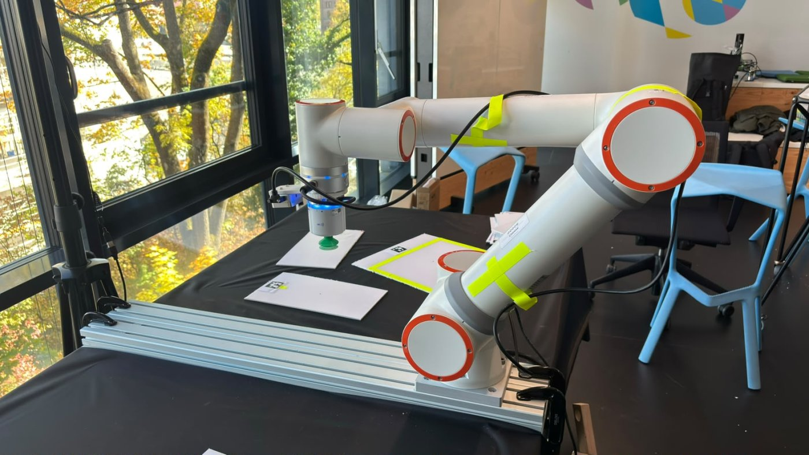
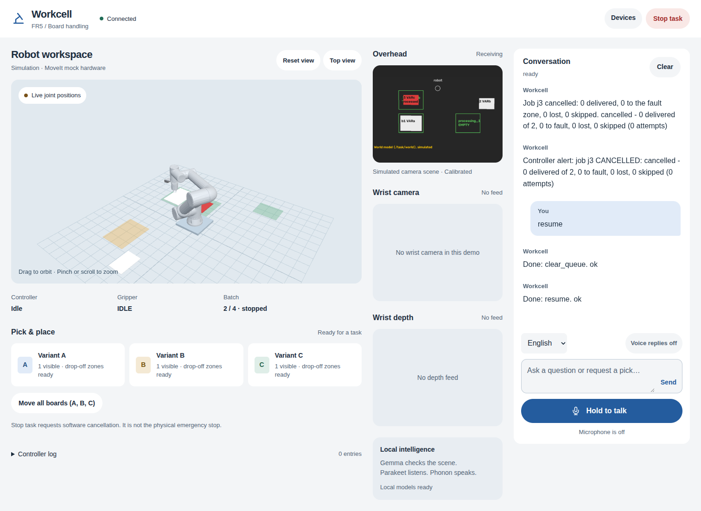
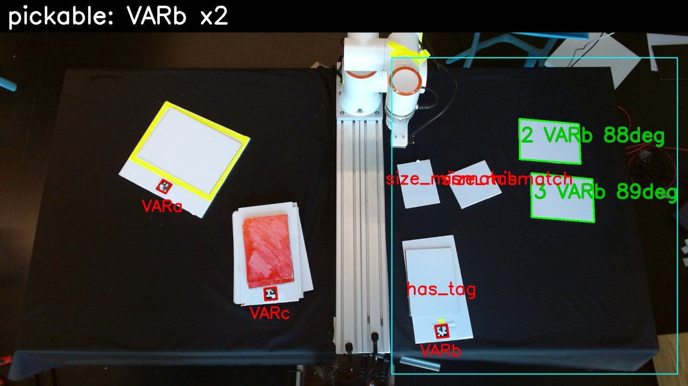
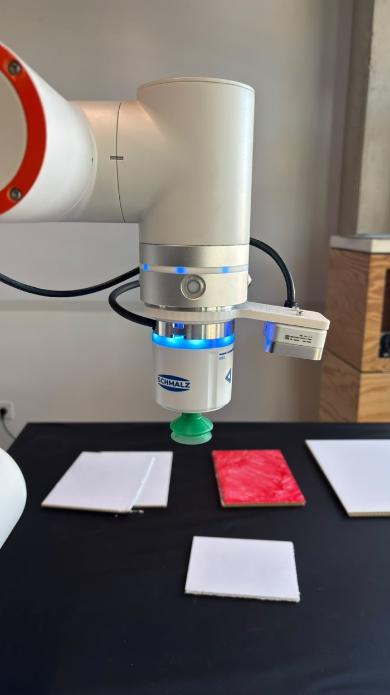
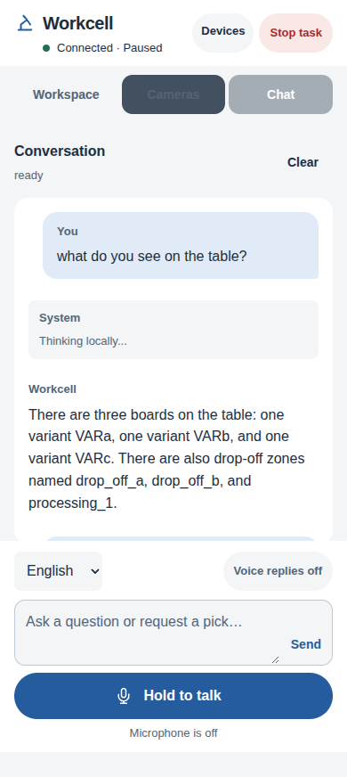
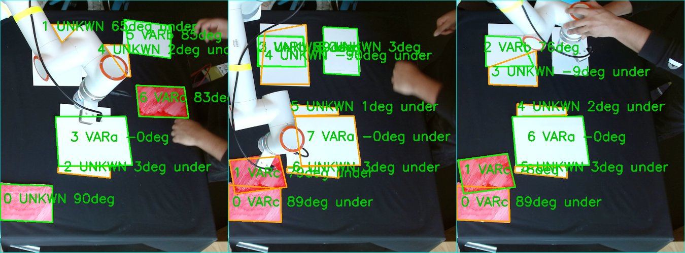
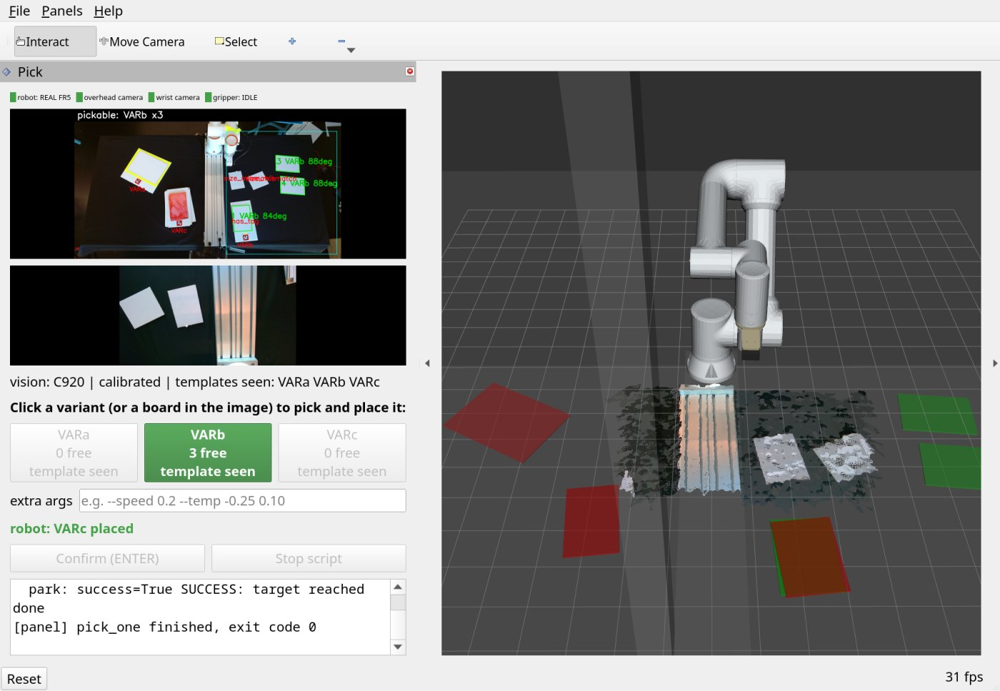
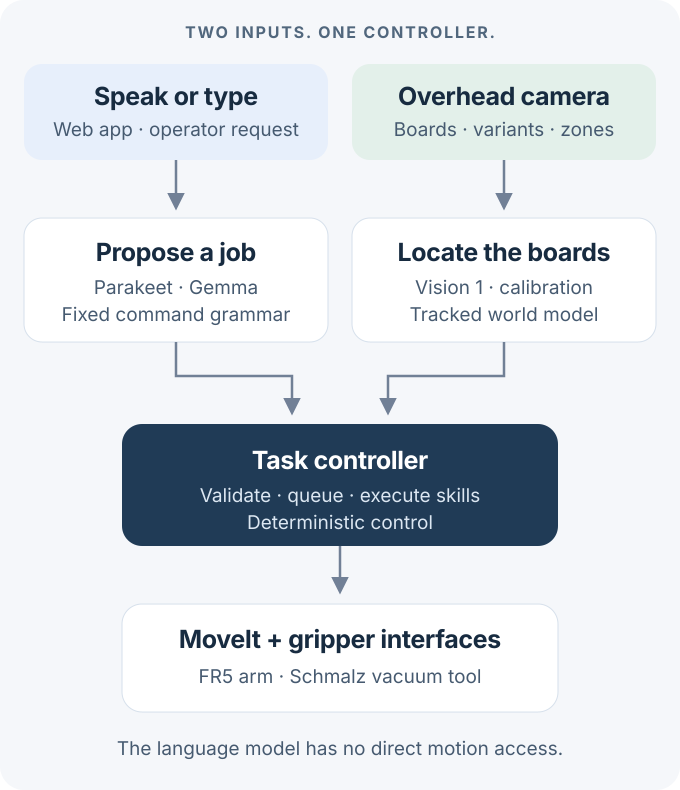

<div align="center">

# The Right Hand

**Voice-guided board handling with a Fairino FR5.**

See the table. Give a job. Follow its progress.

[Start in simulation](#start-in-simulation) · [See the workcell](#see-the-workcell) · [How it works](#how-it-works) · [Tested status](#tested-status) · [Operations guide](docs/OPERATIONS.md)



*The team's lab workcell. Photo from development, not a simulation.*

</div>

A local assistant for moving boards between an input area, a processing zone and output stacks.
The operator gives jobs through a web app. The controller runs the queue and handles recovery.
Gemma proposes commands. Fixed code validates them before the controller accepts them.

**One Pixi workspace. Local models. One terminal to start the stack.**

## Start in simulation

**No robot or cameras required.** Use the checkout that contains this README.
For a new PC, start with the [installation steps](docs/OPERATIONS.md#4-install-on-a-new-workstation).

### 1. Prepare the workspace once

If this checkout is already installed and built, go to step 2.

```bash
pixi install --locked -a
pixi run build
```

**Needs:** Linux x86-64, an NVIDIA GPU with 8 GB or more, and a driver that supports CUDA 12.9.
The first model start needs internet access for the downloads. See [model setup](docs/OPERATIONS.md#47-download-the-models).

### 2. Start the stack

```bash
pixi run up --sim
```

Keep this terminal open. Wait for **All started**.
With cached models, allow about 1 minute. The first model download takes longer.

### 3. Give one job

Open **[localhost:8088](http://localhost:8088)**. In the chat, type:

> move the large white board to drop off a

**Look for:** a queued job, motion in the 3D view, and a completion message.
The arm and board movements in this mode are simulated.



*Desktop screenshot from the integration tests. The wrist panels have no feed because this run uses simulation.*

### 4. Stop when finished

Press **Ctrl+C** in the launcher terminal, or run this from another terminal in the same checkout:

```bash
pixi run down
```

To follow the process output in another terminal, use `pixi run logs`.
The launcher uses direct child processes. It does not need tmux.

> **Using the real robot?** Follow the [hardware startup procedure](docs/OPERATIONS.md#6-start-on-the-real-robot) first.
> The software Stop button is not the hardware emergency stop. Shutdown switches the pumps off.

## See the workcell

### A camera view the controller can use

Vision 1 converts the overhead image into board and zone observations.
The world model tracks those observations for the task controller.



*Recorded lab frame from the vision branch. Green outlines mark accepted candidates. Red labels explain rejection.
The historical overlay labels templates by variant. The current controller uses named processing and drop-off zones.*

| Board | Appearance | Size |
|---|---|---|
| `VARa` | Large white board | 295 × 210 × 5 mm |
| `VARb` | Small white board | 150 × 210 × 5 mm |
| `VARc` | Red board | 135 × 210 × 5 mm |

### The tool. The operator's view.

<table>
<tr>
<td width="50%" align="center"></td>
<td width="50%" align="center"></td>
</tr>
<tr>
<td><strong>Real hardware.</strong> Schmalz vacuum tool with a wrist-mounted RealSense D405.</td>
<td><strong>Phone layout.</strong> Text and voice controls from a simulated browser test.</td>
</tr>
</table>

The wrist camera provides colour and depth views in the web app.
The integrated pick routine currently uses contact search, not wrist depth, to find the board surface.

For phone microphone access, follow the [HTTPS pairing steps](docs/OPERATIONS.md#71-connect-a-phone-or-a-tablet).

<details>
<summary><strong>More lab images: overlap cases and the earlier RViz interface</strong></summary>



*Historical segmentation results on stacked boards. `UNKWN` and overlapping labels remain visible in the original capture.
These examples show difficult cases, not a guarantee that every stack can be separated.*



*Archived lab screenshot. This RViz pick panel and its scripts are retired from the integrated branch.
Use the web app shown above. This image documents the earlier camera and robot integration.*

</details>

## How it works

<p align="center">

</p>

1. **You request a job.** Parakeet turns speech into text. Typed requests enter as text.
2. **Gemma proposes commands.** A fixed grammar checks them. Direct control commands bypass planning.
3. **Vision supplies observations.** Calibration and tracking give the controller board and zone positions.
4. **The controller executes skills.** MoveIt and the gripper interfaces handle motion and suction. Phonon provides spoken replies.

The language model has no direct motion access.
Read the [ROS interfaces](docs/OPERATIONS.md#13-ros-interfaces) for topic, service and action names.

<details>
<summary><strong>Find the code for each part</strong></summary>

| Part | Start here |
|---|---|
| Perception | [Vision 1](vision1/) · [Calibration](config/calib.yaml) |
| Task control | [Controller and skills](src/hk_fr5_task/) |
| Motion and suction | [Motion](src/hk_fr5_motion/) · [Gripper](src/hk_fr5_gripper/) |
| Conversation and web | [Local model integration](conversation/) · [Web app](web/) |
| Startup and tests | [Process launcher](tools/stack.py) · [Test runner](tests/run.sh) |

</details>

## Tested status

**Integration checks from 28 October 2026.** Results describe the local checkout.

| Check | Result | What the result covers |
|---|---|---|
| End-to-end demo | **13 / 13 passed** | Simulated robot, text planning, real local speech models, pause/resume, stop/cancel and request rejection |
| Launcher lifecycle | **6 / 6 passed** | Local process fixtures: startup, failure cleanup, signals, duplicate starts, restart and shutdown ownership |
| Offline suites | **Passed** | Controller logic, recorded vision samples, command grammar and conversation tests |
| Full-stack shutdown | **No session processes remained** | Simulation started and stopped without tmux |

**Hardware boundary:** the photos show the real lab setup. The current launcher has not been tested on the real robot.
These checks do not establish placement accuracy.

<details>
<summary><strong>Run the checks yourself</strong></summary>

For offline checks:

```bash
pixi run test
```

For the end-to-end demo, start `pixi run up --sim` first. In another terminal, run:

```bash
ROS_LOCALHOST_ONLY=1 pixi run python conversation/demo_check.py
```

This test queues jobs and moves the simulated robot.
See the [full test guide](docs/OPERATIONS.md#11-tests) for ROS suites and web checks.

</details>

### Know these three limits

- Same-colour boards that overlap can remain ambiguous. A rectangle does not prove that only one sheet is present.
- Wrist depth is available for viewing. The integrated pick routine still uses contact search.
- An unusual request can produce a wrong plan. Use explicit variants, counts and destinations.

## Keep the next step small

| You need to… | Open this |
|---|---|
| Install on another PC | [Installation guide](docs/OPERATIONS.md#4-install-on-a-new-workstation) |
| Run the real workcell | [Hardware startup](docs/OPERATIONS.md#6-start-on-the-real-robot) · [Shutdown](docs/OPERATIONS.md#9-stop-the-system) |
| Give jobs or connect a phone | [Web and voice commands](docs/OPERATIONS.md#7-use-the-web-app) · [CLI](docs/OPERATIONS.md#8-use-the-command-line) |
| Fix a failed start | [Troubleshooting](docs/OPERATIONS.md#14-troubleshooting) · [Logs](docs/OPERATIONS.md#10-logs) |
| Change or understand the system | [Configuration](docs/OPERATIONS.md#12-configuration-files) · [Design records](docs/OPERATIONS.md#16-design-records) |

The [operations guide](docs/OPERATIONS.md) keeps the complete setup, commands and recovery instructions.
Photo and screenshot sources are recorded in the [image notes](docs/images/README.md).
